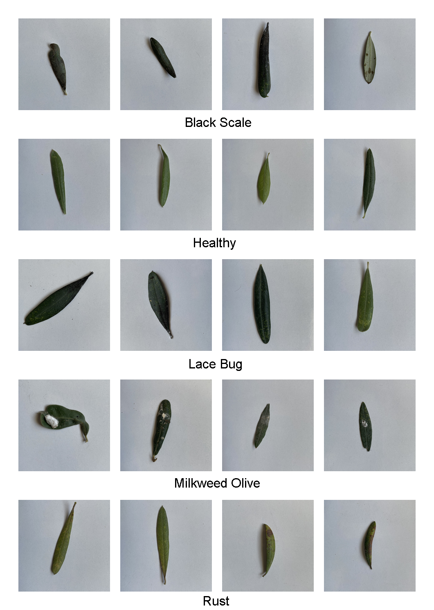
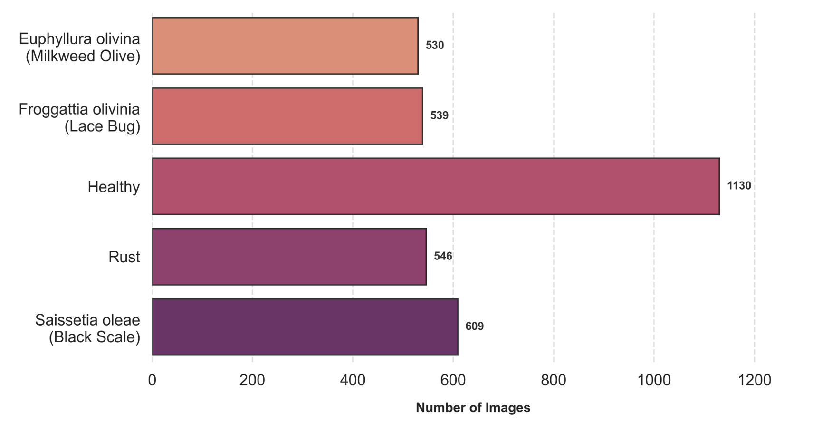

# Oliver: Olive Pest and Disease Classification with ConvNeXt and SE Attention

This repository accompanies **Oliver: A Novel Dataset for Olive Pest and Disease Detection**. It provides representative images from the five Oliver classes and the source code of the proposed **ConvNeXt-Base + Squeeze-and-Excitation (SE) channel attention** classification pipeline.

The principal contribution of the study is **Oliver**, a dataset designed to complement existing olive-leaf collections by including pest and disease appearances that are absent or only indirectly represented in the datasets compared in the paper. The accompanying model provides a common classification pipeline for evaluating Oliver and four external olive-leaf datasets.

**Authors:** Morteza Farrokhnejad, Ali Farrokhnejad, Ali Hakan Ulusoy, and Ahmet Rizaner.

- **Dataset access:** [Oliver dataset website](https://oliver.emu.edu.tr)
- **Repository:** [IAmFarrokhnejad/Oliver](https://github.com/IAmFarrokhnejad/Oliver)
- **Implementation:** [Proposed ConvNeXt-SE notebook](Code/Proposed_ConvNeXt_SE_Olive_Single_Run.ipynb)

## Repository contents

| Path | Description |
| --- | --- |
| `README.md` | Dataset overview, model description, configuration, and execution instructions |
| `Code/Proposed_ConvNeXt_SE_Olive_Single_Run.ipynb` | Single-run training and evaluation pipeline |
| `images/im1.png` | Figure 2 from the paper: sample images from all Oliver classes |
| `images/im2.png` | Figure 3 from the paper: class distribution after augmentation |


The repository contains sample images. The complete Oliver dataset must be obtained separately through the dataset website; the four external datasets must also be supplied separately to run their experiments.

## Oliver dataset

Existing olive-leaf datasets differ in their class definitions, acquisition conditions, and geographical coverage. Several of the datasets examined in the paper emphasize healthy leaves, peacock-eye disease, and *Aculus olearius*. Oliver extends the available label coverage by bringing Milkweed Olive, Lace Bug, Black Scale, Healthy, and Rust appearances into a single five-class classification task.

The dataset originates from **1,865 original images** acquired on working olive farms across several regions of Cyprus, during the period from mid-July to the end of October. The images were manually annotated by multiple experts from different institutions. The prepared collection described in the paper contains **3,354 image files**, including augmented images, at **224 × 224 pixels** in PNG format.

### Classes and sample images



*Figure 2. Sample images from each class of the Oliver dataset.*

| Dataset label | Description | Prepared image count |
| --- | --- | ---: |
| Milkweed Olive | *Euphyllura olivina* | 530 |
| Lace Bug | *Froggattia olivinia* | 539 |
| Healthy | Healthy olive leaves | 1,130 |
| Rust | Operational category based on rust-like visual symptoms | 546 |
| Black Scale | *Saissetia oleae* | 609 |
| **Total** | **Five classes** | **3,354** |

The Rust label describes an appearance-based category; it does not establish a single confirmed biological cause. Likewise, the association of Milkweed Olive and Black Scale with sooty mould does not make these pest labels equivalent to a sooty-mould class in another dataset. Oliver complements the compared datasets rather than reproducing their taxonomies.

### Class distribution



*Figure 3. Definitive class distribution after augmentation, as presented in the paper.*

The counts above describe the prepared collection, rather than the number of independently acquired leaves or the split sizes produced by the notebook. The paper describes conversion from HEIC to PNG, region-of-interest cropping, Lanczos downscaling, and class-selective augmentation during dataset preparation. These preparation steps are separate from the training-time transformations implemented in the notebook.

## Proposed classification model

The implementation uses **ConvNeXt-Base initialized with ImageNet-1K V1 weights**. An SE module recalibrates the final backbone feature map before global average pooling and classification. All model parameters are trainable.

| Component | Implementation |
| --- | --- |
| Input | 224 × 224 RGB image |
| Backbone | `torchvision.models.convnext_base` |
| Pretrained weights | `ConvNeXt_Base_Weights.IMAGENET1K_V1` |
| Attention position | After backbone feature extraction, before global average pooling |
| SE bottleneck | 1,024 → 128 → 1,024 channels; reduction ratio of 8 |
| SE operations | Adaptive average pooling, two bias-free linear layers, ReLU, sigmoid, and channel-wise multiplication |
| Classification head | Retained ConvNeXt normalization and flattening, with a final linear layer adapted to the dataset's class count |
| Dropout | No additional dropout layer |

The model produces class logits. Softmax probabilities and predicted classes are calculated during evaluation. A separate model is trained for each dataset; the notebook does not train a shared model on a merged collection or evaluate cross-dataset transfer.

## Experimental configuration

| Setting | Value |
| --- | --- |
| Training / validation / test split | Approximately 64% / 16% / 20%, stratified when supported by class counts |
| Split seed | `1201` |
| Training seed | `1201` |
| Training batch size | `16` |
| Validation and test batch size | `32` |
| Maximum epochs | `50` |
| Optimizer | AdamW |
| Initial learning rate | `1e-4` |
| Weight decay | `1e-2` |
| Learning-rate scheduler | Cosine annealing over 50 epochs |
| Loss | Cross-entropy weighted by inverse training-class frequency |
| Early stopping | 10 consecutive epochs without improved validation accuracy |
| Final model selection | Restore the weights with the best validation accuracy before test evaluation |
| Data loader workers | `0` by default |

Training images are resized to 256 × 256, randomly cropped to 224 × 224, and transformed using horizontal and vertical flips, color jitter, and rotations of up to ±15°. Validation and test images are resized directly to 224 × 224. All subsets use ImageNet normalization with mean `[0.485, 0.456, 0.406]` and standard deviation `[0.229, 0.224, 0.225]`.

CUDA is selected automatically when available, with automatic mixed precision during training and evaluation. Otherwise, execution falls back to the CPU. Python, NumPy, and PyTorch seeds are fixed, and deterministic behavior is requested where supported. Numerical results can still vary across software versions and hardware.

## Setup and execution

### 1. Install the dependencies

Use a Python environment with PyTorch, torchvision, NumPy, pandas, scikit-learn, Matplotlib, Pillow, and JupyterLab:

```bash
python -m pip install torch torchvision numpy pandas scikit-learn matplotlib pillow jupyterlab
```

For GPU execution, install compatible PyTorch and torchvision builds for your CUDA environment. The command above does not pin the full environment used in the study.

The stored notebook output records the following versions:

| Dependency | Recorded version |
| --- | --- |
| Python | `3.13.2` |
| PyTorch | `2.10.0+cu126` |
| torchvision | `0.25.0+cu126` |
| NumPy | `2.3.5` |
| pandas | `2.3.3` |
| scikit-learn | `1.8.0` |

The paper reports an NVIDIA GeForce RTX 4070 Laptop GPU, Intel Core i7-13620H CPU, 16 GB RAM, and Windows 11. These describe the reported experimental hardware rather than minimum system requirements. Internet access is needed for the initial download of pretrained weights unless they are already cached locally.

### 2. Prepare the dataset folders

The notebook supports two input layouts:

| Configuration | Required folder layout |
| --- | --- |
| `kind="presplit"` | A dataset root containing `train/<class_name>/`, with optional `test/<class_name>/` and one of `val/<class_name>/`, `valid/<class_name>/`, or `validation/<class_name>/` |
| `kind="flat"` | A dataset root containing `<class_name>/` folders directly |

For a presplit Oliver collection, examples of valid image paths are `Oliver/train/Healthy/image001.png` and `Oliver/test/Black Scale/image002.png`. Use consistent class-folder names across subsets. Class indices are assigned according to alphabetically sorted folder names; for presplit inputs, the class list is discovered from `train/`.

Supported extensions are `.jpg`, `.jpeg`, `.png`, `.bmp`, `.tif`, `.tiff`, and `.webp`. Images are converted to RGB when loaded. Each class must contain enough records for the requested stratified split; the few sample images in this repository are intended for illustration rather than reproduction of the reported results.

### 3. Configure the notebook

Open the notebook and edit **Section 2: Experiment configuration**. The supplied configuration contains unfinished entries of the form `"root": #Specify this path`. Each must be replaced with a valid value and a trailing comma before the configuration cell can execute, for example:

```python
"root": Path("D:/datasets/Oliver"),
```

Use the actual path on your machine. Absolute paths avoid ambiguity about the notebook's working directory.

The default configuration includes:

| Configuration name | Dataset | Default layout |
| --- | --- | --- |
| `dataset1_oliver` | Oliver | `presplit` |
| `dataset2_uguz` | Uğuz and Uysal | `presplit` |
| `dataset3_diker` | Diker et al. | `flat` |
| `dataset4_zeytin_augmented` | Zeytin Augmented | `presplit` |
| `dataset5_osco_mamani` | Osco-Mamani and Chaparro-Cruz | `presplit` |

To run **Oliver only**, replace the entire `DATASET_CONFIGS` list with the following, substituting your own root:

```python
DATASET_CONFIGS = [
    {
        "name": "dataset1_oliver",
        "kind": "presplit",
        "root": Path("D:/datasets/Oliver"),
        "train_split_name": "train",
        "test_split_name": "test",
        "val_split_names": ["val", "valid", "validation"],
        "image_size": 224,
    }
]
```

If your images are organized directly into class folders, change `"kind"` to `"flat"`. Keep the model and training settings fixed when evaluating the supplied configuration. Set `RESULTS_DIR` to a writable output location if needed.

### 4. Run the pipeline

From the repository root, start JupyterLab:

```bash
jupyter lab Code/Proposed_ConvNeXt_SE_Olive_Single_Run.ipynb
```

Select the Python kernel associated with your environment and execute the cells in order. **Section 9 starts training** once for every dataset listed in `DATASET_CONFIGS`. A dataset-loading or training error stops execution rather than silently skipping that dataset.

## Split behavior and reproduction scope

**The `presplit` option describes the input folder structure; it does not preserve the existing train, validation, and test assignments.** The notebook pools images from the available split folders and creates a new split: 20% of pooled records are reserved for testing, then 20% of the remaining records are reserved for validation. This produces approximately 64/16/20 overall, subject to integer rounding.

The loader removes duplicate file paths, but it does not identify duplicate image content, source leaves, or augmentation families. If the supplied collection contains multiple images of the same source or pre-generated augmented variants, keep related records within the same partition when designing an evaluation. The default notebook does not implement this grouping, so record-level resplitting alone does not establish independence between source images and their derivatives.

The notebook implements training-time augmentation and class-weighted loss. It does not implement the paper's offline HEIC conversion, cropping, Lanczos preparation, or class-selective generation of additional image files.

**The released notebook runs one experiment per configured dataset.** The paper reports averages across **ten repeated holdout runs per dataset**. A single execution therefore demonstrates the pipeline and produces a single-run result, rather than regenerating those reported averages. Reproducing the aggregate results requires the corresponding repetition protocol, seeds, data preparation, and split handling.

For all datasets, including binary tasks, metric names ending in `macro` or `weighted` use those exact averaging schemes. The notebook exports accuracy, precision, recall, and F1 metrics; it does not compute AUC/AUROC. Best-validation weights are restored in memory for testing, but no trained-model checkpoint is saved by the supplied implementation.

## Generated outputs

Results are written under `results_proposed_convnext_se_single_run/` by default, relative to the kernel's working directory. Each dataset receives its own subdirectory.

| Per-dataset file | Contents |
| --- | --- |
| `split_manifest.csv` | Relative image paths, assigned split, numeric label, and class name |
| `split_distribution.png` | Class counts in each split |
| `training_history.csv` | Epoch losses, validation accuracy, validation macro-F1, and learning rate |
| `loss_curve.png` | Training and validation loss curves |
| `validation_metrics_curve.png` | Validation accuracy and macro-F1 curves |
| `test_metrics.csv` | Test accuracy and macro/weighted precision, recall, and F1 |
| `classification_report.csv` | Class-wise precision, recall, F1, and support, plus aggregate rows |
| `confusion_matrix.csv` | Test confusion matrix with class labels |
| `confusion_matrix.png` | Visualized test confusion matrix |
| `test_predictions.csv` | True and predicted numeric labels and class names |

The output root also contains `single_run_summary.csv`, with performance, split sizes, best epoch, training time, parameter counts, and peak allocated GPU memory, and `cross_dataset_test_metrics.png`, comparing the configured datasets' single-run metrics. Exported metric values use a 0–1 scale.

## Results reported in the paper

The following are **manuscript-reported averages across ten runs**, not results guaranteed by one execution of this notebook.

| Dataset | Mean accuracy (%) | Macro-F1 (%) |
| --- | ---: | ---: |
| Oliver | 96.18 | 96.90 |
| Uğuz and Uysal | 98.41 | 98.42 |
| Diker et al. | 99.32 | 99.29 |
| Zeytin Augmented | 98.98 | 98.95 |
| Osco-Mamani and Chaparro-Cruz | 94.90 | 94.88 |

These are independent within-dataset experiments. Differences in labels, image acquisition, preparation, and evaluation protocols limit direct comparisons between datasets and with other published studies.

## Dataset access and citation

The full Oliver dataset is available to researchers upon request through the [Oliver dataset website](https://oliver.emu.edu.tr). Consult the access instructions and applicable usage terms provided there.

If you use Oliver or this implementation in academic work, cite the associated paper, **TBA**, and acknowledge this repository. When using an external dataset, also cite its original authors and follow its usage terms. Final journal, DOI, and publication details should be taken from the published paper when available.
